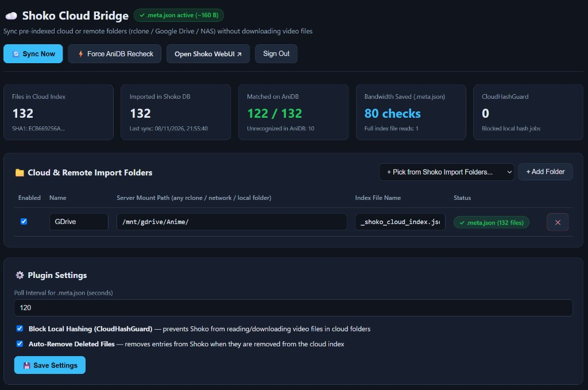

# Shoko Cloud Bridge

A plugin for **Shoko Server** and companion cloud indexer that imports remote/cloud anime libraries (**Google Drive, OneDrive, seedboxes, or rclone mounts**) into Shoko and Jellyfin **without downloading any video files to your local server**.

Pre-hash your library once in the cloud (e.g. on Google Colab or your seedbox), and Shoko will link everything with AniDB, TMDB, and Jellyfin using pure cryptographic hashes.

> <sub>**Author's Note:** This project was developed entirely with AI (Google Antigravity). Basically I haven't tested it on other machines except mine and don't really want to unless someone really needs it, although it should work or you can ask an AI agent for help. I did it because I found no solution online. Design looks like AI-slop which it literally is.</sub>



---

## Features

- **Zero Video Downloads:** Hashes (`ED2K`, `CRC32`, `MD5`, `SHA1`) and `MediaInfo` are precomputed in the cloud and injected directly into Shoko's database. Your local server downloads 0 MB of video.
- **Traffic-Saving Beacon (`.meta.json`):** Writes a tiny ~160-byte metadata file alongside the index. Shoko only checks this beacon, so your server never repeatedly downloads the full 1MB+ index file.
- **Accidental Hash Guard:** Intercepts Shoko's Quartz scheduler and automatically kills any local hash jobs targeting cloud folders, preventing accidental multi-gigabyte downloads.
- **Web UI & Settings Panel:** Accessible directly on your Shoko Server port at `/CloudBridge`. Manage cloud folders, change poll intervals, and trigger manual syncs with your normal Shoko account.
- **Universal Storage:** Works with any folder accessible to your server — Google Drive, OneDrive, Dropbox, Mega, remote VPS/seedbox over SMB/NFS/SSHFS, or any `rclone` mount.

---

## How It Works

1. **Cloud Indexer** (`cloud_indexer.py` or Colab notebook) scans your remote anime folder using native `librhash` (fast C library with live progress bars). It generates:
   - `_shoko_cloud_index.json` (full hashes + MediaInfo)
   - `_shoko_cloud_index.meta.json` (~160 bytes: update timestamp, SHA1, and file count)
2. **ShokoCloudBridge Plugin** checks the 160-byte `.meta.json` every 1-2 minutes.
3. When changes are detected, it reads the index, adds files to Shoko DB, and asks AniDB for episode metadata via lightweight UDP packets.
4. **Shokofin** in Jellyfin sees the new episodes immediately and presents them in your library.

---

## Quick Start

### 1. Pre-index Your Files

#### Option A: Google Colab (Best for Google Drive)
Open [`Shoko_GDrive_Cloud_Indexer.ipynb`](Shoko_GDrive_Cloud_Indexer.ipynb) in Google Colab:
1. Run **Step 1** to mount Google Drive and enter your anime path (e.g. `MyDrive/Anime` or `Shareddrives/MyAnime/Anime`).
2. Run **Step 2** to compute hashes. It shows live progress, speed (MB/s), and ETA.
   - Files already indexed are skipped in milliseconds.
   - Renamed or moved files keep their hashes without re-reading.

#### Option B: Standalone Script (Linux / Seedbox / VPS)
```bash
sudo apt-get install -y rhash librhash0 mediainfo python3-tqdm
python3 cloud_indexer.py --path "/path/to/remote/anime"
```

---

### 2. Install the Plugin in Shoko Server

*(Tested with **Shoko Server v5.3.3.0**, Docker image `ghcr.io/shokoanime/server:latest`, .NET 8.0).*

The plugin runs in-process inside Shoko Server and listens on **whatever HTTP port your Shoko Server uses** (default `8111`, or your custom mapped Docker port).

#### If using Docker (`shoko_server`):
1. Put `ShokoCloudBridge.cs`, `build_and_install.sh`, and `compiler_bin/` on your host.
2. Run the build script to compile directly inside the container using Shoko's built-in Roslyn compiler:
```bash
# Auto-detects shoko_server or shoko-server, default port 8111:
chmod +x build_and_install.sh
./build_and_install.sh

# Or specify custom container / port:
SHOKO_CONTAINER=shoko_server SHOKO_PORT=8112 ./build_and_install.sh
```

*(Alternatively, place a precompiled `ShokoCloudBridge.dll` directly into your `Shoko.CLI/plugins/` directory and restart the container).*

---

### 3. Setup in Shoko & Web UI

1. **In Shoko WebUI (`Settings` -> `Import Folders`):**
   - Add your cloud mount folder path (e.g. `/mnt/cloud/Anime/`).
   - Set **Drop Type:** `None` (not `Source` or `Destination`).
   - Set **Watch For New Files:** `No` (prevents Shoko's native file watcher from polling or downloading files over cloud/network mounts).
2. **In CloudBridge WebUI (`http://<server-ip>:<shoko-port>/CloudBridge`):**
   - Sign in with your Shoko Server credentials.
   - Under **Cloud & Remote Import Folders**, pick your folder from the dropdown or enter its path.
   - Click **Sync Now** (or wait for the auto-sync interval).

---

### 4. Recommended Jellyfin / Shokofin Settings

If you use Jellyfin with Shokofin VFS:

- **Disable LUFS Audio Scan:** In Jellyfin, go to your cloud library config (`options.xml`) and set:
  ```xml
  <EnableLUFSScan>false</EnableLUFSScan>
  ```
  *Why:* Jellyfin's default audio loudness normalization will attempt to download entire video files from your cloud mount.
- **Enable SignalR:** In Shokofin plugin settings, turn on auto-connect (`<SignalR_AutoConnectEnabled>true</SignalR_AutoConnectEnabled>`) so Jellyfin updates immediately when Shoko finishes importing.

---

## Configuration (`ShokoCloudBridge.config.json`)

Settings can be changed via the `/CloudBridge` Web UI or directly in `plugins/ShokoCloudBridge.config.json`:

```json
{
  "poll_interval_seconds": 120,
  "block_local_hashing": true,
  "auto_remove_deleted_files": true,
  "cloud_folders": [
    {
      "name": "Cloud",
      "folder_path": "/mnt/cloud/Anime/",
      "index_file_name": "_shoko_cloud_index.json",
      "meta_file_name": "_shoko_cloud_index.meta.json",
      "enabled": true
    }
  ]
}
```

---

## Project Structure

- `ShokoCloudBridge.cs` — Source code for the Shoko plugin (Web API + Background Service + Quartz Guard).
- `cloud_indexer.py` — Python 3.8+ script with C-bindings to `librhash` for fast hashing with dual progress bars.
- `Shoko_GDrive_Cloud_Indexer.ipynb` — Google Colab notebook for indexing Google Drive libraries.
- `build_and_install.sh` — Helper script to build the plugin inside the Shoko Docker container.
- `compiler_tool/` — Micro-compiler source using in-container Roslyn DLLs (`dotnet build compiler_tool/Compiler.csproj -c Release -o compiler_bin`).
